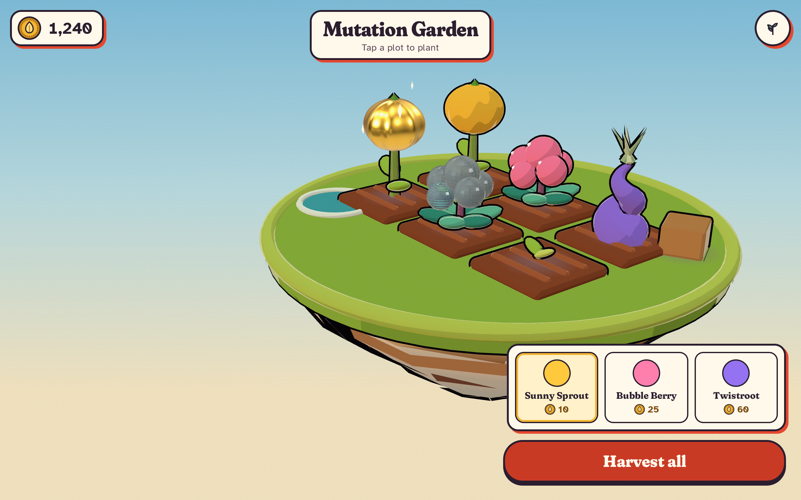

# Mutation Garden

Plant a seed, watch something strange grow, harvest it, and find out what it can turn into. A small 3D gardening game for phone browsers, built with Three.js.

**Status: pre-production.** There is no game yet. The live page at https://aieatassam.github.io/mutation-garden/ shows a blank canvas. The art direction is approved and the repo is set up for the build to start with Milestone 1.



*Look prototype, not the game. The world is drawn like an old seed catalogue; mutations, such as the gold fruit and the glass berries, are the only things that look real.*

## What's here

| Path | What |
|---|---|
| `docs/brief.md` | The design brief |
| `docs/art/style-guide.md` | The Seed Packet art direction, palette and rules |
| `docs/architecture.md` | How the code is split, and why |
| `docs/milestones/` | M1–M5, with M1 broken into tasks |
| `AGENTS.md`, `.codex/` | Instructions and agent roles for building this with Codex |

## Run it

```
npm install
npx playwright install chromium
npm run dev       # local dev server
npm run check     # every gate: palette, types, lint, unit, build, e2e
```

Needs Node 20.19 or newer.

## Licence

[MIT](LICENSE)
