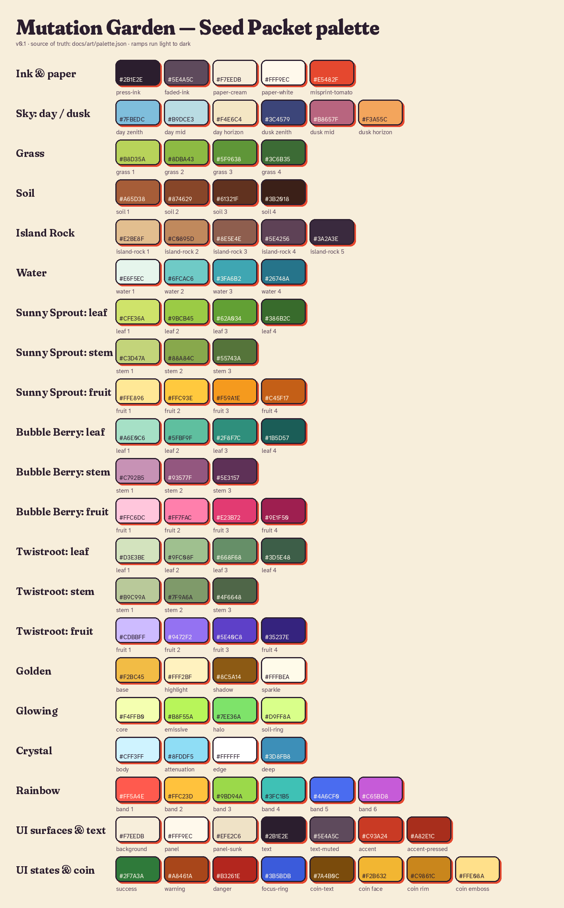

# Mutation Garden style guide: Seed Packet

Status: v0.1 draft, waiting for approval. This file is the single source of truth for how the game looks. Colour values live in [palette.json](palette.json). When this file and palette.json disagree, palette.json wins and this file gets fixed.

Why this direction was picked, and the alternatives, are in [directions.md](directions.md).

## 1. The idea in one line

**The world is printed. Mutations are real.**

Ordinary things are toon-shaded in three flat bands, outlined in warm ink, with a light paper grain over the frame. A mutation swaps the plant's material from print to a physically based material: metal, glass, light or iridescence. Rarity reads from the material change alone.

## 2. Concept targets and prototype

These are targets, not finished art. The three concept images were AI-generated to explore the mood, so treat proportions and details in them as loose. Plant names and shapes in this guide override anything in the images.

The image tool saved the concepts outside this repo, so they were shared in chat and still need to be saved into `docs/art/concepts/` under these names. The prototype renders are already in the repo.

| File | What it shows |
|---|---|
| `concepts/concept-island.jpg` | Concept target: the island with Sunny Sprout, Bubble Berry and Twistroot |
| `concepts/concept-mutation-lineup.jpg` | Concept target: one fruit as Normal, Giant, Golden, Glowing, Crystal, Rainbow |
| `concepts/concept-ui-layout.jpg` | Concept target: UI labels, seed tray and coin (the generator would only make landscape) |
| `prototype/shots/proto-phone-day.png` | Real three.js render at 390×844 using palette.json, with Golden and Crystal mutations |
| `prototype/shots/proto-phone-dusk.png` | The same at dusk |
| `prototype/shots/proto-desktop-day.png` | Desktop layout, 1280×800 |

The prototype in `prototype/` is an art-direction sketch, not game code. To re-render it, see `prototype/README.md`.

## 3. Palette

All values are sRGB hex. Ramps run light to dark. In three.js, pass hex strings to `new THREE.Color()` and keep colour management on.

### 3.1 Ink and paper

| Name | Hex | Use |
|---|---|---|
| Press Ink | `#2B1E2E` | All outlines, UI text, UI borders. Never pure black. |
| Faded Ink | `#5E4A5C` | Secondary text, captions |
| Paper Cream | `#F7EEDB` | UI background, paper grain base |
| Paper White | `#FFF9EC` | Panels, labels, text on accent |
| Misprint Tomato | `#E5482F` | Offset shadow under UI labels |

### 3.2 Environment

| Group | Steps (light → dark) |
|---|---|
| Sky, day | zenith Catalogue Blue `#7FBEDC`, mid Duck Egg `#B9DCE3`, horizon Paper Haze `#F4E6C4` |
| Sky, dusk | zenith Indigo Ink `#3C4579`, mid Rose Madder `#B8657F`, horizon Marigold Haze `#F3A55C` |
| Clouds | lit `#FFF6E3`, shade `#E6D3B8`; dusk lit `#FFD3A8`, dusk shade `#9C6A86` |
| Grass | Pea Shoot `#B8D35A`, Sweet Basil `#8DBA43`, Meadow `#5F9638`, Viridian Shade `#3C6B35` |
| Soil | Fresh Tilth `#A65D38`, Terracotta Loam `#874629`, Loam `#61321F`, Peat `#3B2018` |
| Soil, watered | `#7A3E25`, `#5A2C1B`, `#3F1F15` (swap in for 3 s after watering, then fade back) |
| Island rock | Sandstone `#E2BE8F`, Ochre Clay `#C0895D`, Burnt Umber `#8E5E4E`, Mulberry Shadow `#5E4256`, Deep Mulberry `#3A2A3E` |
| Water | Foam `#E6F5EC`, Verdigris `#6FCAC6`, Pool `#3FA6B2`, Deep Pool `#26748A` |
| Wood (crate, fences) | `#E0B57A`, `#B9844E`, `#7E5333` |

Rule: shadows go towards mulberry and indigo, never grey or black. That is the printed-ink feel.

### 3.3 Starter plants

| Plant | Leaf | Stem | Fruit |
|---|---|---|---|
| Sunny Sprout | `#CFE36A` `#9BCB45` `#62A034` `#386B2C` | `#C3D47A` `#88A84C` `#55743A` | Butter `#FFE896`, Marigold `#FFC93E`, Tangerine `#F59A1E`, Burnt Orange `#C45F17` |
| Bubble Berry | `#A6E0C6` `#5FBF9F` `#2F8F7C` `#1B5D57` | `#C792B5` `#93577F` `#5E3157` | Blush `#FFC6DC`, Bubblegum `#FF7FAC`, Raspberry `#E23B72`, Mulberry Jam `#9E1F50` |
| Twistroot | `#D3E3BE` `#9FC08F` `#668F68` `#3D5E48` | `#B9C99A` `#7F9A6A` `#4F6648` | Lilac `#CDBBFF`, Violet `#9472F2`, Ultramarine Root `#5E40C8`, Night Root `#35237E` |

Each species owns one hue family for its fruit (warm yellow-orange, pink-red, violet) and a leaf green that is visibly different from the other two (yellow-green, blue-green, sage). Players should tell the three apart in greyscale by silhouette and in colour by fruit hue alone. New species must claim a free hue family.

How to use a ramp with the 3-band toon shader: the material colour is step 2. Step 1 is the rim and highlight, step 3 the core shadow, and step 4 is reserved for growth-stage tinting (unripe fruit starts at step 4 and warms to step 2 when ripe).

### 3.4 Mutation treatments

Every mutation keeps the plant's silhouette so the species stays readable. Mutations stack. When two apply, use the higher-tier material and keep the other as an effect (for example Giant + Golden = golden material at giant scale).

| Mutation | Material | Recipe | Extras | Mobile fallback |
|---|---|---|---|---|
| **Giant** | Same toon material | Scale 1.8× (range 1.6–2.2). Fruit colour shifts one step darker (step 3 as base). Outline width ×1.5. | Heavier motion: squash 0.75, slower settle. Bigger blob shadow. Soil crack decal. | None needed |
| **Golden** | `MeshStandardMaterial` | color Gilt `#F2BC45`, metalness 1.0, roughness 0.22, envMap = small PMREM of a warm studio (RoomEnvironment works), envMapIntensity 1.4. No outline. | 3 four-point sparkle sprites in Sparkle `#FFFBEA`, twinkling at random. | Matcap texture baked from the same look (one texture lookup) |
| **Glowing** | `MeshToonMaterial` + emissive | color Core `#F4FFB0`, emissive `#B8F55A`, emissiveIntensity pulses 1.2–2.2 over 1.6 s. Outline in Viridian Shade instead of ink. | Additive halo sprite `#7EE36A` at 2.2× radius, opacity 0.35. Soil ring decal `#D9FF8A`. No bloom pass needed. | Same; halo sprite only |
| **Crystal** | `MeshPhysicalMaterial` | color Ice `#CFF3FF`, transmission 0.92, thickness 0.6, ior 1.45, roughness 0.04, attenuationColor `#8FDDF5`, attenuationDistance 0.8, flatShading true on a low-poly (detail 1) version of the fruit. No outline. | White edge glints on facets. | Fresnel shader: alpha 0.55 in the middle, 0.95 at edges, tinted Deep `#3D8FB8`, plus a matcap. Transmission is the most expensive thing in the game. Cap it at 3 crystal objects on screen, then fall back. |
| **Rainbow** | `MeshPhysicalMaterial` | color `#FFFFFF`, metalness 0.3, roughness 0.18, iridescence 1.0, iridescenceIOR 1.3, iridescenceThicknessRange [120, 800]. Add a hue band shader that scrolls up the fruit over 3 s through the six bands. | Bands: `#FF5A4E` `#FFC23D` `#9BD94A` `#3FC1B5` `#4A6CF0` `#C65BD8` | Band shader on the toon material, no iridescence |

Rarity order, low to high: Giant, Glowing, Golden, Crystal, Rainbow. The higher the tier, the further it moves from the printed look.

### 3.5 UI colours and contrast

| Role | Hex |
|---|---|
| Background | `#F7EEDB` Paper Cream |
| Panel | `#FFF9EC` Paper White |
| Sunk panel (wells, inputs) | `#EFE2C6` |
| Border | `#2B1E2E` Press Ink |
| Text | `#2B1E2E` Press Ink |
| Muted text | `#5E4A5C` Faded Ink |
| Accent (primary buttons) | `#C93A24` Seed Red, pressed `#A82E1C` |
| Misprint shadow | `#E5482F` |
| Coin face / rim / emboss | `#F2B632` / `#C9861C` / `#FFE08A` |
| Coin amount text | `#7A4B0C` |
| Success | `#2F7A3A` |
| Warning | `#A8461A` |
| Danger | `#B3261E` |
| Focus ring | `#3B5BDB` |

WCAG 2.x contrast, computed by `tools/contrast.py` (target 4.5:1 for text, 3:1 for UI graphics). All pairs pass:

| Pair | Foreground | Background | Ratio | Target | Result |
|---|---|---|---|---|---|
| text on background | `#2B1E2E` | `#F7EEDB` | 13.71:1 | 4.5:1 | pass |
| text on panel | `#2B1E2E` | `#FFF9EC` | 15.07:1 | 4.5:1 | pass |
| text on panel-sunk | `#2B1E2E` | `#EFE2C6` | 12.32:1 | 4.5:1 | pass |
| muted text on background | `#5E4A5C` | `#F7EEDB` | 6.98:1 | 4.5:1 | pass |
| muted text on panel | `#5E4A5C` | `#FFF9EC` | 7.67:1 | 4.5:1 | pass |
| button label on accent | `#FFF9EC` | `#C93A24` | 4.86:1 | 4.5:1 | pass |
| button label on accent-pressed | `#FFF9EC` | `#A82E1C` | 6.51:1 | 4.5:1 | pass |
| accent text on panel | `#C93A24` | `#FFF9EC` | 4.86:1 | 4.5:1 | pass |
| coin amount text on panel | `#7A4B0C` | `#FFF9EC` | 7.05:1 | 4.5:1 | pass |
| success text on panel | `#2F7A3A` | `#FFF9EC` | 5.05:1 | 4.5:1 | pass |
| warning text on panel | `#A8461A` | `#FFF9EC` | 5.63:1 | 4.5:1 | pass |
| danger text on panel | `#B3261E` | `#FFF9EC` | 6.23:1 | 4.5:1 | pass |
| ink text on coin face (large numerals) | `#2B1E2E` | `#F2B632` | 8.67:1 | 4.5:1 | pass |
| border vs background (UI graphic) | `#2B1E2E` | `#F7EEDB` | 13.71:1 | 3.0:1 | pass |
| focus ring vs panel (UI graphic) | `#3B5BDB` | `#FFF9EC` | 5.40:1 | 3.0:1 | pass |
| ink on sky horizon (in-world labels) | `#2B1E2E` | `#F4E6C4` | 12.77:1 | 4.5:1 | pass |
| ink on sky zenith (in-world labels) | `#2B1E2E` | `#7FBEDC` | 7.76:1 | 4.5:1 | pass |

Rule: text never sits directly on the 3D scene or the sky. It sits on a paper label. The dusk prototype showed why: ink on an indigo sky is unreadable.

## 4. Lighting

The look depends on authored colour, so lighting is simple and fixed.

| | Day | Dusk |
|---|---|---|
| Key (directional, from upper left, about 45° up) | `#FFE7C4`, roughly 4800 K, intensity 2.2 | `#FFA36E`, roughly 2800 K, intensity 2.4 |
| Fill (hemisphere, sky colour) | `#A9D3EA`, roughly 9000 K | `#6266A6` |
| Fill (hemisphere, ground colour) | `#B98A62` warm bounce | `#7A4A4A` |
| Rim (shader term, not a light) | `#FFF4D6` at 35% where facing ratio < 0.22 | `#FFD7A8` |

- Toon shading: `MeshToonMaterial` with a 3-pixel gradient map (values 90, 175, 255) using nearest filtering. Three bands, no smooth gradients.
- Tone mapping off (`NoToneMapping`) so authored colours land as written. Mutation materials get their richness from the environment map, not from tone mapping.
- No real-time shadows. Use these instead:
  - **Blob shadows.** One 128 px radial gradient texture in Deep Mulberry at 55% centre opacity, on a quad under each plant, crate and dropped fruit. Scale it with the object and shrink it as the object jumps.
  - **Baked ambient occlusion.** Darken vertex colours where the island cap meets the rock and at plot edges, baked once at load.
  - **Plot rims.** Plots sit 0.1 units proud of the grass so the outline does the contact work.
- Environment map: a single small PMREM, built once at startup and used only by mutation materials.
- Time of day: day and dusk are two presets that cross-fade over 2 s. Don't simulate the sun continuously.

## 5. Shape language

- **Base shapes.** Spheres, capsules, discs and rounded boxes. Corner radius at least 8% of the object's size. No sharp corners anywhere except crystal facets and sparkles, which are sharp on purpose because they are special.
- **Proportions.** Fruit is oversized: 35–50% of the plant's height. Stems are short and thick: at least 0.07 units wide, so the outline never breaks up.
- **Outline.** Inverted hull. Back faces pushed out along the normal by 0.035 units (0.06 on the island rock), in Press Ink. Mutations with real materials drop the outline. Glowing uses a Viridian Shade outline.
- **Paper grain.** Screen-space noise multiplied at 15–22% opacity. One fixed texture that never animates.
- **Island.** A thick grass disc with a lighter rounded lip, sitting on a chunky, faceted rock cone that bands from Sandstone to Deep Mulberry. Never smooth-shade the rock.

### Silhouette rules per plant

Each plant must be identifiable as a solid black shape at 48 px tall.

| Plant | Silhouette | Must have | Must not |
|---|---|---|---|
| Sunny Sprout | Lollipop: one tall stem, one big round fruit on top, two round leaves low down | Fruit on top, wider than the leaves. 8 shallow ribs on the fruit. | Petals. A face. It is not a sunflower. |
| Bubble Berry | Low dome: a ring of leaves with a cluster of 4–6 round berries above them | Berries of different sizes, touching, each with a small cream highlight dot | A single berry. Tall stems. |
| Twistroot | Corkscrew: a fat violet root twisting up out of the soil, tapering to a point, with a spiky tuft of sage leaves | The twist (2–3 visible turns) and the soil bulge at the base | Round fruit. Anything that reads as a carrot or a beetroot. |

## 6. UI style

- **Labels, not windows.** Every UI element is a printed label: a Paper White rounded rectangle, a 3 px Press Ink border, an 18 px corner radius (14 px on small cards), and a 4 px offset Misprint Tomato shadow down and to the right. No blur, no glassmorphism, no gradients, no drop shadows in grey.
- **Primary buttons.** Pill shape, 56–64 px tall, Seed Red fill, Paper White label, 3 px ink border, 5 px solid ink "base" shadow below. When pressed, the button moves down 5 px and the base shadow goes to 0, as if pressing a stamp.
- **Touch targets.** At least 48×48 px. The main actions live in the bottom third of a portrait screen. Nothing important goes in the top 60 px, which is reserved for coins and the journal button.
- **Type pairing** (both free, SIL Open Font License, on Google Fonts):
  - **Fraunces** for display: titles, plant names, buttons, rewards. Use the variable axes: SOFT 100 (rounded terminals), WONK 1, opsz matched to size, weight 650–800. It looks like old seed-packet lettering without being a pastiche.
  - **Atkinson Hyperlegible** for everything you read quickly: numbers, prices, timers, tooltips. Use tabular figures for counters. It was designed for low-vision readers, which suits small phone screens.
  - Don't add a third face. No script fonts in the UI.
  - Sizes on a 390 px wide screen: display 34/26/20 px, body 17 px, small 15 px. Nothing under 13 px.
- **Icons.** Drawn like the world: 2 px Press Ink strokes, rounded caps and joins, flat fills from the palette, a 24 px grid. No outline-only icons and no emoji.
- **The Seed Token coin.** A round token with a ridged rim (`#C9861C`), a marigold face (`#F2B632`) with a dashed inner ring, and an embossed seed in the centre (`#FFE08A`) with a sprout line. Ink outline. In 3D it is a thick disc with the same colours; collected coins flip once and fly to the counter.
- **Writing.** Plain and short. "Tap a plot to plant." "Ready to harvest." No exclamation marks except on a rare mutation reveal. No filler words such as "magical", "unlock your potential" or "embark".

## 7. Logo and wordmark

- The wordmark is **Mutation Garden** in Fraunces Black, SOFT 100, WONK 1, set tight (−1% tracking), in Press Ink, on a seed-packet label: a Paper White rectangle with a scalloped top edge and the tomato misprint shadow.
- The dot of the **i** in "Mutation" is a small fruit. In static use it is a Marigold Sunny Sprout fruit. In motion, such as the title screen and loading, it cycles through the mutation treatments: normal, giant (it swells), golden, glowing, crystal, rainbow.
- App icon: just that fruit, Golden, on a Catalogue Blue disc with an ink outline. It works at 48 px.
- Small print under the wordmark on the title screen, in Atkinson Hyperlegible, set like a catalogue line: "Seeds for impossible plants". (Placeholder copy, to be reviewed.)

## 8. Motion principles

1. **Everything lands.** A seed drops, overshoots into the soil (squash to 0.7 height, 1.25 width), and springs back over 220 ms. Use spring easing with light damping, not ease-in-out.
2. **Growth is a stepped pop, not a slow scale.** Each growth stage pops in 160 ms (scale 0.85 → 1.08 → 1.0) with a puff of soil particles. Between stages, the plant breathes: ±2% vertical scale on a 2.4 s loop, with offsets per plant so the garden doesn't move in sync.
3. **Ripe means wobble.** A ripe fruit wiggles every 3 s and shows a soft halo in its fruit step 1 colour. That is the harvest signal, with no exclamation icons.
4. **Harvest is the reward.** The fruit stretches upward (1.3 tall), detaches, arcs to the crate in 450 ms with a slight spin, and squashes on landing. Coins flip out and fly to the counter, which ticks up one coin at a time with a quick bump.
5. **Mutations get a moment.** On a first-time mutation, time slows to 30% for 600 ms, the camera moves 10% closer, the material change wipes across the fruit from bottom to top, and a label stamps in: "New mutation: Golden". That is the only exclamation-mark moment in the game. Repeat mutations skip the slow-down.
6. **Small things ease, big things spring.** UI uses short ease-outs (120–180 ms). World objects use springs.
7. **Reduced motion.** With `prefers-reduced-motion` or the in-game setting: no slow-down, no camera move, no breathing, and squash amplitude halved. Pops become 120 ms fades. Rewards stay just as clear.

## 9. Performance budget for the look

- Toon materials everywhere except mutations: one material per palette colour, shared.
- Outline hulls share one material. Skip them on objects smaller than 12 px on screen.
- Draw calls under 150 on the main garden view. Instance the grass tufts, furrow capsules and blob shadows.
- One environment map, built at startup. Crystal transmission is capped at 3 objects on screen.
- No post-processing on the default tier. Paper grain is a CSS overlay or one full-screen quad.

## 10. Open questions for approval

- Is the printed-catalogue look right, or should the ink outline be softer (a dark shade of each object's own colour instead of one ink)?
- Dusk: keep it as an occasional time-of-day moment, or drop it from the first release?
- Should coins be the Seed Token above, or something more plant-based, such as a dried seed pod?
